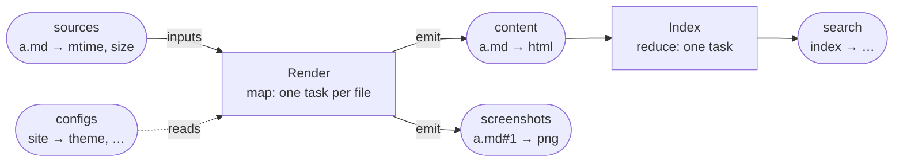
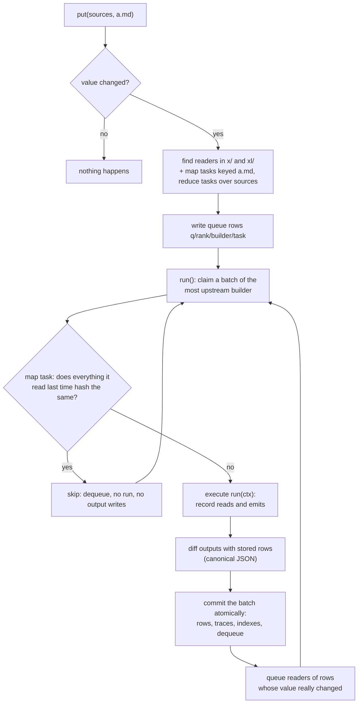
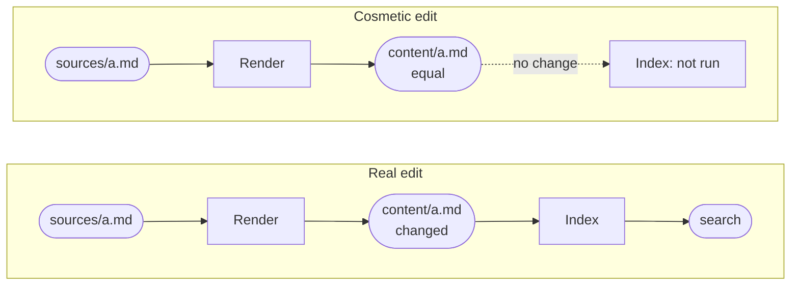
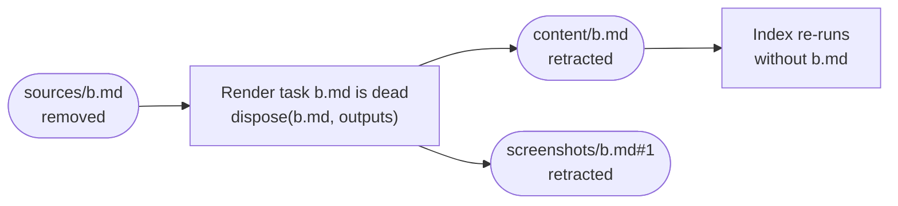
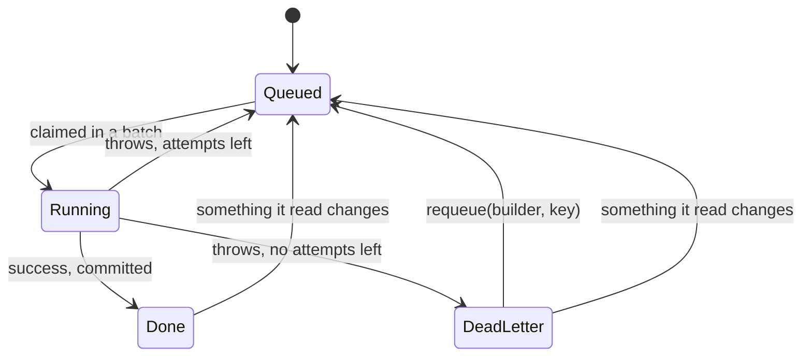
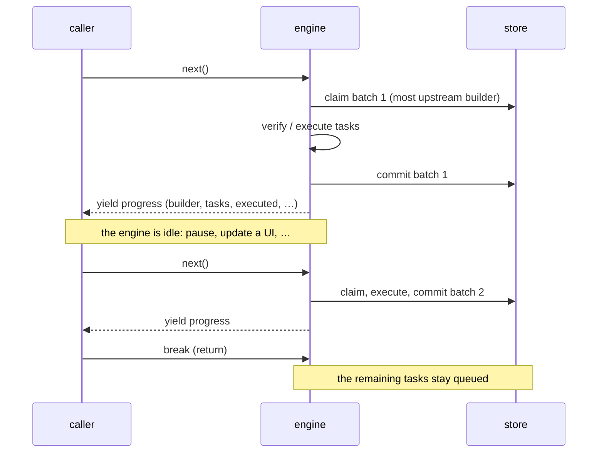
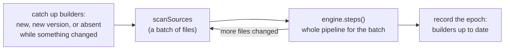

# How the build engine works

This document explains how `@statewalker/webrun-builder` runs builds: what it stores, how a change
travels through the builders, why unchanged outputs stop the work early, how deletions and failures
are handled, and how to run a build step by step. The [README](../README.md) is the API reference;
this is the mental model behind it. A worked example, re-indexing a document folder, is in
[use-case-reindexing.md](use-case-reindexing.md).

## Contents

1. [Collections and builders](#1-collections-and-builders)
2. [Everything lives in one ordered key-value store](#2-everything-lives-in-one-ordered-key-value-store)
3. [What happens when a file changes](#3-what-happens-when-a-file-changes)
4. [Early cut-off: an equal output stops the wave](#4-early-cut-off-an-equal-output-stops-the-wave)
5. [Deletion: retraction cascades, dispose cleans up](#5-deletion-retraction-cascades-dispose-cleans-up)
6. [Three kinds of builder](#6-three-kinds-of-builder)
7. [Failures and dead letters](#7-failures-and-dead-letters)
8. [Running in steps](#8-running-in-steps)
9. [Persistence and tuning](#9-persistence-and-tuning)
10. [In a project: ProjectBuilder](#10-in-a-project-projectbuilder)

## 1. Collections and builders

A **collection** is a named set of rows; each row is a key and a JSON value. A **source**
collection is written from outside the engine, for example by `scanSources`, which mirrors a folder:
one row per file, keyed by its path, valued by `{ mtime, size }`. Every other collection is written
by **builders**, and each of its rows has exactly one producing task.

A builder is a function the engine runs per **task**:

- a **map** builder (the default) has one task per key present in any of its `inputs`;
- a **reduce** builder has a single task, `"*"`, that aggregates whole collections.

One task may read several collections and emit to several. Here one map task reads a file and the
site configuration, and produces both the rendered content and screenshots; a reduce builder then
indexes all the content:



```ts
const render: BuilderDef = {
  id: "Render",
  inputs: ["sources"],                 // one task per file
  reads: ["configs"],                  // may also read these
  outputs: ["content", "screenshots"],
  async run(ctx) {
    const file = await ctx.get("sources", ctx.key);  // tracked read
    const cfg = await ctx.get("configs", "site");    // tracked read
    ctx.emit("content", ctx.key, { html: renderPage(file, cfg) });
    ctx.emit("screenshots", `${ctx.key}#1`, { png: shoot(file) });
  },
  dispose(key, outputs) {
    // the file is gone: delete what run() wrote outside the engine
  },
};
```

The builder graph (which builder reads which collection) is declared up front. *Which rows* a task
reads is discovered while it runs: every `ctx.get` and `ctx.list` is recorded as a dependency of
that task. The rows a task emits in a successful run are its **output set**, and each row has exactly
one producing task.

## 2. Everything lives in one ordered key-value store

The engine keeps no state in memory between runs. Rows, the work queue, each task's trace and the
dependency indexes are all records in one ordered key-value store that offers three operations:
`get`, prefix `scan`, and an atomic multi-key `commit`. That is why the same engine runs over
memory (`MemKV`), a folder of JSON files (`FilesKV`) or SQLite (`SqlKV`), and why a build killed at
any point resumes where it stopped.

| Prefix | Record | Purpose |
|---|---|---|
| `r/collection/key` | owner + JSON value | The rows. The owner is the task that emitted the row (empty for a source row). |
| `q/rank/builder/task` | queue row (attempts, lease) | Tasks to run. `rank` is the builder's topological position, so a prefix scan returns the most upstream work first. |
| `f/builder/task` | trace | What the task read (`r`), listed (`l`) and emitted (`o`); fingerprints of what it read (`i`, `rh`); incremental state (`s`). |
| `x/collection/key/builder/task` | reverse index | "Who read this row?" A changed row queues exactly these tasks. |
| `xl/collection/builder/task` | list index | "Who listed this whole collection?" Any change in it queues these. |
| `c/builder/collection/key` | change record | For incremental reduces: the value a row had at the task's last run. |
| `d/builder/task` | dead letter | A task that failed `maxAttempts` times, with its error. |

Key parts are joined with U+0001, which sorts below every printable character, so a prefix of parts
is a prefix of the key. (Not U+0000: SQLite truncates text at NUL.)

## 3. What happens when a file changes

Writing a source row does not run anything. It marks work: the tasks that depend on the row are
queued. `run()` then drains the queue, the most upstream builder first, in batches that each commit
atomically.



1. **Mark.** `put` compares the new value with the stored one. If they differ, the engine looks up
   the readers of that row in the reverse indexes, adds the map tasks keyed by it, and writes queue
   rows. An equal value writes nothing.
2. **Order.** Queue keys start with the builder's topological rank, so the engine always claims the
   most upstream dirty builder first. A downstream task never runs on half-updated inputs
   (the build is *glitch-free*), and a task with several changed inputs runs once.
3. **Verify before execute.** A map task's trace holds a fingerprint of every row it read. If they
   all hash the same now, the task is dequeued without running. This makes a change undone before
   the run (A → B → A) and spurious re-queues cheap. It does not apply to tasks that listed a
   collection, to reduce builders, or to tasks after `invalidate` / `requeue`, which drop the
   fingerprints so the task runs once more.
4. **Execute and diff.** The task runs; the rows it emits are compared with the stored ones using
   canonical JSON. Rows it no longer emits are retracted.
5. **Commit and cascade.** Rows, the trace, index entries and the dequeue go into one atomic commit
   per batch (*group commit*). Only rows whose value really changed queue their readers, and the
   loop continues until the queue is empty.

A crash at any moment loses at most the batch that was being executed; its queue rows are still in
the store, so the next run executes it again.

## 4. Early cut-off: an equal output stops the wave

Re-emitting a value equal to the stored one is not a change. A whitespace edit that renders to the
same HTML re-runs `Render`, but `content/a.md` comes out equal, so `Index` does not run:



Builders can rely on this on purpose. An expensive step (an LLM summary, an embedding) can emit a
small fingerprint row, such as `{ hash, v }` for the source hash and a schema version, instead of the
whole artifact, and keep the artifact itself in files. Downstream tasks then re-run exactly when the
fingerprint changes.

## 5. Deletion: retraction cascades, dispose cleans up

When a key disappears from every input of a map builder, its task is **dead**. The engine first
calls `dispose(key, outputs)`, so the builder can delete what it wrote outside the engine (files,
index entries). It then retracts every row the task emitted, in the same commit. Each retracted row
is a change, so its readers run in turn: a removed file empties its whole downstream chain.



No separate "removed" signal or pruning pass is needed. A task that simply stops emitting a row (a
page with fewer screenshots than before) has that row retracted the same way. `dispose` runs before
the retraction commits, so after a crash it may run again: keep it idempotent.

## 6. Three kinds of builder

| Kind | Tasks | Re-runs when | Typical use |
|---|---|---|---|
| `kind: "map"` (default) | one per key present in any input | a row it read changed; dead when its key is gone from all inputs | extract, render, embed, summarize |
| `kind: "reduce"` | one, `"*"` | anything it read or listed changed; runs at least once | totals, sitemap, global index |
| `kind: "reduce"`, `incremental: true` | one, `"*"` | as above, but it folds only the changes | full-text index, topic graph |

An incremental reduce reads `ctx.changes(collection)`: the rows changed since its last successful
run, each with its current value (`undefined` if removed) and its value at that run. It keeps what
it has folded so far in `ctx.state` / `ctx.setState`. When there is no state (the first run, or after
`invalidate`), it rebuilds from `ctx.list`.

## 7. Failures and dead letters



A failure never stops the pipeline:

- the failing task is retried later in the same run, up to `maxAttempts` (default 3);
- after that it moves to the dead letter list, `deadLetters()`, with its error;
- its **previous outputs are kept**, so downstream builders keep working with the last good result;
- the other tasks converge as usual;
- `requeue(builder, key)`, or a change to anything the task read, runs it again.

Commits are guarded by each task's claim, so a crashed or stale engine cannot write half a result.
With `shared: true`, several processes can share one store (`SqlKV`): claims become leases taken
with conditional writes, and a crashed engine's leases expire after `leaseMs`.

## 8. Running in steps

`run()` has a generator form, `steps()`. It yields one `RunProgress` per committed batch and returns
the run's `RunStats`. The engine waits at every `yield`. At that point nothing is in flight: the
batch is committed and no claim is held. The caller can pause as long as it likes, or stop, and the
next run continues from the queue. `run()` is simply `steps()` drained.



```ts
let tasks = 0;
for await (const p of engine.steps({ signal })) {   // p = { builder, tasks, executed, skipped, failed, … }
  tasks += p.tasks;
  if (tasks >= 100) {
    tasks = 0;
    await new Promise((r) => setTimeout(r, 100));   // let the UI breathe, or break
  }
}
```

- **One record per batch.** A batch is up to `batchSize` tasks of one builder. Set `batchSize: 1`
  to get one record per task, at the cost of one commit per task.
- **One run at a time.** A suspended generator holds the engine, so a second `run()` or `steps()` is
  refused until it finishes. `break` or an exception in the loop releases it. A generator dropped
  half-way keeps the engine locked.
- **`maxTasks` and `signal`** work as in `run()`: the run stops between batches and reports
  `pending: true` if work is left. `onProgress` still fires for every batch.

## 9. Persistence and tuning

```ts
const engine = await createBuildEngine({
  builders: [render, index],
  persistence: { kind: "files", files, path: "/.state/build" },
  // or { kind: "memory" } · { kind: "sql", driver } · { kind: "custom", store }
  concurrency: 8,   // tasks of one batch run in parallel (I/O, LLM calls)
  batchSize: 64,    // tasks per atomic commit
  maxAttempts: 3,   // then dead letter
});
await scanSources(engine, { files, root: "/docs" });
const stats = await engine.run({ onProgress: (p) => console.log(p.builder, p.executed) });
```

- **`persistence`** chooses the store; the engine's behaviour is identical on all of them. `FilesKV`
  keeps its rows in memory and appends log segments, so it allows one writer per folder; `SqlKV` can
  be shared by several processes.
- **`concurrency`** runs the tasks of one batch in parallel. They are independent because a builder
  never reads its own outputs.
- **`batchSize`** trades crash granularity for commit cost: a crash loses at most one batch, while
  larger batches make cold builds cheaper.
- **`scanSources({ limit, after })`** scans a large corpus in batches, each run through the whole
  pipeline before the next, so terminal builders (indexes) fill in early.

## 10. In a project: ProjectBuilder

In the StateWalker kernel, `@statewalker/workspace.core` wraps the engine as `ProjectBuilder`.
Project natures (web app, wiki, notebooks) register builders, and each run scans the project's
files into `sources` and drains the queue:



- State persists by default under the project's `.project/state/build` (`configurePersistence`
  picks another store).
- A builder registered after the files were scanned, or with a new `version`, has all its tasks
  queued before the next run, so it covers every existing file.
- `run({ retryFailed: false, failOnError: false })` leaves an expensive failing step alone until its
  input changes and reports it in `failures`.
- `steps()` yields the scans and the engine batches.
- Hosts that take turns on one project (browser tabs, a CLI) call `reopen()` when they take the lease,
  so the store is read again.
