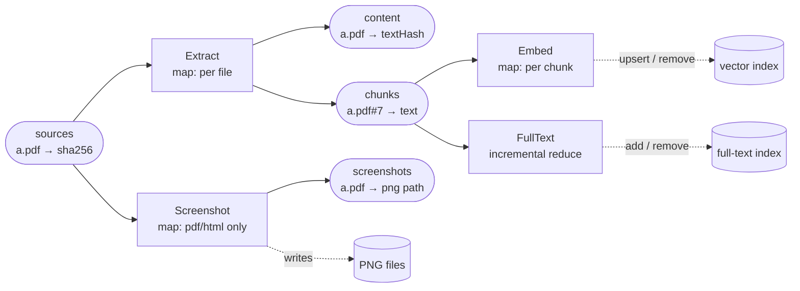
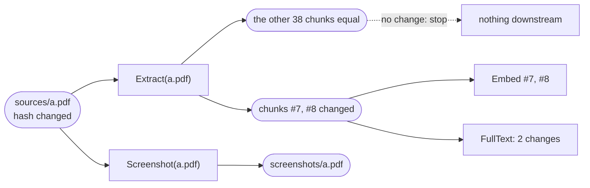

# Use case: re-indexing a document folder

A folder of PDFs and HTML pages is turned into extracted text, chunks, a full-text index, a vector
index and screenshots. When files change, only the affected pieces are rebuilt: an edited paragraph
re-embeds two chunks, not the whole corpus, and a deleted file takes its vectors, index entries and
screenshot with it.

This page shows the builders, the change-detection loop, and what each kind of change re-runs. How
the engine itself works is in [how-it-works.md](how-it-works.md).

## Contents

1. [The pipeline](#the-pipeline)
2. [The builders](#the-builders)
3. [Detecting changes and rebuilding](#detecting-changes-and-rebuilding)
4. [One edit, followed through](#one-edit-followed-through)
5. [What each change re-runs](#what-each-change-re-runs)
6. [Forcing a rebuild when code or config changes](#forcing-a-rebuild-when-code-or-config-changes)
7. [In a project](#in-a-project)

## The pipeline

Four builders over five collections. The collections hold small JSON rows: fingerprints, chunk
text, paths. The heavy artifacts live in external stores (the full-text index, the vector index,
PNG files) and are kept in step with the rows by `run` and `dispose`.



| Builder | Kind | What it does |
|---|---|---|
| `Extract` | map over `sources` | One task per file. Emits a text fingerprint and one row per chunk (`a.pdf#0`, `a.pdf#1`, …). Chunks it stops emitting are retracted automatically. |
| `Screenshot` | map over `sources` | PDF and HTML only. Writes the PNG to the cache folder; `dispose` deletes it when the file goes away. |
| `Embed` | map over `chunks` | One task per chunk, so only changed chunks are re-embedded. Upserts the vector; `dispose` removes it when the chunk is retracted. |
| `FullText` | incremental reduce over `chunks` | One task that folds only what changed in `chunks` since its last run: adds new and changed chunks, removes retracted ones. |

## The builders

The index and extractor functions at the top are placeholders shaped like `statewalker-search`;
swap in the real calls.

```ts
import {
  type BuilderDef,
  createBuildEngine,
  scanSources,
  SOURCES_COLLECTION,
} from "@statewalker/webrun-builder";
import type { FilesApi } from "@statewalker/webrun-files";

// ---- placeholders: swap in statewalker-search and your extractors ----------
interface FullTextIndex {
  add(id: string, text: string): Promise<void>;
  remove(id: string): Promise<void>;
  clear(): Promise<void>;
  flush(): Promise<void>;
}
interface VectorIndex {
  upsert(id: string, v: Float32Array): Promise<void>;
  remove(id: string): Promise<void>;
}
declare function extractText(files: FilesApi, path: string): Promise<string | undefined>;
declare function screenshot(files: FilesApi, path: string): Promise<Uint8Array>;
declare function embed(text: string, model: string): Promise<Float32Array>;
declare function sha256(data: string | Uint8Array): Promise<string>;
/** Splits on paragraph / heading boundaries, so an edit changes only the chunks it touches. */
declare function splitIntoChunks(text: string): string[];

const EMBED_MODEL = "text-embedding-3-small";

export function indexingBuilders(deps: {
  docs: FilesApi;          // the folder being indexed
  cache: FilesApi;         // where screenshots go
  fullText: FullTextIndex;
  vectors: VectorIndex;
}): BuilderDef[] {
  const { docs, cache, fullText, vectors } = deps;

  // 1. Extract: one task per file. Emits a small fingerprint row plus one row per chunk.
  const extract: BuilderDef = {
    id: "Extract",
    inputs: [SOURCES_COLLECTION],
    outputs: ["content", "chunks"],
    async run(ctx) {
      const text = await extractText(docs, `/${ctx.key}`);
      if (!text) return;                                   // not extractable: no rows
      ctx.emit("content", ctx.key, { textHash: await sha256(text) });
      splitIntoChunks(text).forEach((chunk, i) =>
        ctx.emit("chunks", `${ctx.key}#${i}`, { text: chunk }),
      );
      // A chunk the document no longer has (#39 when it shrank to 38 chunks) is simply not
      // emitted again: the engine retracts it, and the retraction cascades to Embed and FullText.
    },
  };

  // 2. Screenshot: pdf/html only. The PNG lives outside the engine, so dispose deletes it.
  const shot: BuilderDef = {
    id: "Screenshot",
    inputs: [SOURCES_COLLECTION],
    outputs: ["screenshots"],
    async run(ctx) {
      if (!/\.(pdf|html?)$/i.test(ctx.key)) return;
      const png = await screenshot(docs, `/${ctx.key}`);
      const path = `/shots/${ctx.key}.png`;
      await cache.write(path, [png]);
      ctx.emit("screenshots", ctx.key, { path, hash: await sha256(png) });
    },
    async dispose(key) {                                   // the file is gone (or ignored)
      await cache.remove(`/shots/${key}.png`).catch(() => {});
    },
  };

  // 3. Embed: one task per chunk, so only changed chunks are re-embedded (they cost money).
  const embedChunks: BuilderDef = {
    id: "Embed",
    inputs: ["chunks"],
    outputs: ["vectors"],
    async run(ctx) {
      const chunk = (await ctx.get("chunks", ctx.key)) as { text: string };
      await vectors.upsert(ctx.key, await embed(chunk.text, EMBED_MODEL));
      ctx.emit("vectors", ctx.key, { model: EMBED_MODEL, hash: await sha256(chunk.text) });
    },
    async dispose(key) {                                   // chunk retracted: drop its vector
      await vectors.remove(key);
    },
  };

  // 4. FullText: one incremental reduce over all chunks. It folds only the changes.
  const fullTextIndex: BuilderDef = {
    id: "FullText",
    kind: "reduce",
    incremental: true,
    inputs: ["chunks"],
    outputs: ["fulltext"],
    async run(ctx) {
      let count = (ctx.state as { chunks: number } | undefined)?.chunks;
      if (count === undefined) {
        // First run, or after invalidate("FullText"): rebuild the index from every chunk.
        await fullText.clear();
        const rows = await ctx.list("chunks");
        for (const row of rows) await fullText.add(row.key, (row.value as { text: string }).text);
        count = rows.length;
      } else {
        for (const c of await ctx.changes("chunks")) {
          if (c.value === undefined) {                                   // retracted
            await fullText.remove(c.key);
            count--;
          } else {                                                       // new or changed
            await fullText.add(c.key, (c.value as { text: string }).text);
            if (c.previous === undefined) count++;
          }
        }
      }
      await fullText.flush();
      ctx.setState({ chunks: count });
      ctx.emit("fulltext", "index", { chunks: count });
    },
  };

  return [extract, shot, embedChunks, fullTextIndex];
}
```

## Detecting changes and rebuilding

Change detection is `scanSources`: it mirrors the folder into the `sources` collection, one row per
file. With a content hash as the fingerprint, a touch or a re-save with identical bytes writes
nothing, so nothing downstream runs. Removed files are removed from `sources`, which retracts
everything derived from them.

```ts
const engine = await createBuildEngine({
  builders: indexingBuilders({ docs, cache, fullText, vectors }),
  persistence: { kind: "files", files: cache, path: "/.index-state" },  // resumable across restarts
  concurrency: 8,   // 8 extractions / embeddings in parallel within a batch
  batchSize: 16,
});

/** One re-index pass: detect changes, then rebuild only what depends on them. */
async function reindex(signal?: AbortSignal) {
  // Change detection: one `sources` row per file, valued by a content hash.
  const scan = await scanSources(engine, {
    files: docs,
    root: "/",
    fingerprint: async (_info, uri) => sha256(await readAll(docs, `/${uri}`)),
  });
  console.log(`scan: ${scan.changed} changed, ${scan.removed} removed, ${scan.seen} files`);

  // Rebuild, one committed batch at a time: pause or stop between batches.
  for await (const p of engine.steps({ signal })) {
    console.log(`${p.builder}: ${p.executed} run, ${p.skipped} skipped, ${p.failed} failed`);
    await new Promise((r) => setTimeout(r, 0));   // yield to the UI / event loop
  }
  for (const d of await engine.deadLetters()) {
    console.warn(`stuck: ${d.builder}/${d.key}: ${d.error}`);
  }
}

// One pass at a time: a tick that comes while a pass is running is skipped.
let running: Promise<void> | undefined;
const tick = () => {
  running ??= reindex()
    .catch(console.error)
    .finally(() => {
      running = undefined;
    });
};
await reindex();                                  // cold start: indexes everything
setInterval(tick, 30_000);                        // or call tick() from a file watcher
```

`readAll` is a helper that reads the whole file into one byte array. Leave out `fingerprint` to use
the default `{ mtime, size }`: cheaper, but a plain touch counts as a change. Run one `reindex()` at
a time (the guard above); the engine refuses a second run while one is in progress.

## One edit, followed through

`a.pdf` was edited: two of its forty paragraphs changed. The scan writes one changed row; the engine
follows it only as far as values actually change.



Two embedding calls instead of forty, and the other 999 files are not touched. This relies on chunks
following paragraph boundaries (as `splitIntoChunks` does here): with fixed-size chunks, an edit
that changes the text's length shifts every later chunk boundary, and those chunks re-embed too.

## What each change re-runs

| Change on disk | Tasks that run | What is skipped |
|---|---|---|
| Cold start, 1,000 PDFs | Extract ×1000, Screenshot ×1000, Embed × every chunk, FullText ×1 (full build from `ctx.list`) | Nothing |
| `a.pdf` edited, 2 of 40 paragraphs changed | Extract(a), Screenshot(a), Embed(#7, #8), FullText folding 2 changes | 38 chunks come out equal: no re-embedding (early cut-off) |
| `a.pdf` re-saved, same text, new bytes | Extract(a), Screenshot(a) | All chunks equal: no Embed, no FullText |
| `a.pdf` touched, same bytes | Nothing | The hash fingerprint is unchanged, so no row is written |
| `a.pdf` shrank from 40 to 38 chunks | Extract(a); `#38` and `#39` are retracted, so Embed disposes their vectors and FullText removes them | Unchanged chunks |
| `b.pdf` deleted | b's Extract and Screenshot tasks are dead: retracted, the PNG is deleted; every Embed task of b disposes its vector; FullText removes b's chunks | Every other file |
| `c.pdf` added | c's tasks only, plus one FullText fold | Every other file |
| Extraction of `d.pdf` throws | Extract(d) is tried 3 times (`maxAttempts`), then becomes a dead letter; Screenshot(d) runs as usual | d's previous chunks and vectors stay; the rest of the run completes. `reindex()` does not requeue dead letters, so d is retried when it changes (or call `engine.requeue`) |
| Process killed mid-run | The next `reindex()` resumes from the queue; at most one batch is redone | Everything already committed |

## Forcing a rebuild when code or config changes

Some changes are not in the files: a new embedding model, a different chunk size, an index that was
wiped. `invalidate(builder)` queues every task of one builder; downstream builders still re-run only
where outputs change.

```ts
// New embedding model: re-embed every chunk; the full-text index is untouched.
await engine.invalidate("Embed");
await reindex();

// Changed the chunking: Extract re-runs; only chunks whose text actually changed
// are re-embedded and re-indexed (equal chunks stop at the `chunks` collection).
await engine.invalidate("Extract");
await reindex();

// Rebuild the full-text index: its state is dropped, so the next run clears the index
// and re-adds every chunk.
await engine.invalidate("FullText");
await reindex();
```

## In a project

In the StateWalker kernel the same builders go into `ProjectBuilder` (`@statewalker/workspace.core`)
through `registerBuilder`, with `run(ctx, project)` instead of `run(ctx)`. The scan is done for you,
state persists under `.project/state/build`, and a builder's `version` replaces the manual
`invalidate`: bump it and its tasks re-run before the next build. `ProjectBuilder` scans with the
default `{ mtime, size }` fingerprint, so there a touch re-runs `Extract` and `Screenshot` for that
file (equal chunks still stop there), and `docs` must be the project's files rooted at the project.

```ts
import { ProjectBuilder, type RegisteredBuilder } from "@statewalker/workspace.core";

const builder = project.requireAdapter(ProjectBuilder).configureEngine({ concurrency: 8 });
for (const b of indexingBuilders({ docs, cache, fullText, vectors })) {
  const registered: RegisteredBuilder = {
    ...b,
    version: b.id === "Embed" ? EMBED_MODEL : undefined,  // new model: Embed re-runs by itself
    run: (ctx, _project) => b.run(ctx),
  };
  builder.registerBuilder(registered);
}

// Scan + rebuild in one call, step by step.
for await (const step of builder.steps({ retryFailed: false, failOnError: false })) {
  if (step.kind === "scan") console.log(`scan: ${step.changed} changed, ${step.removed} removed`);
  else console.log(`${step.builder}: ${step.executed} run`);
}
```
